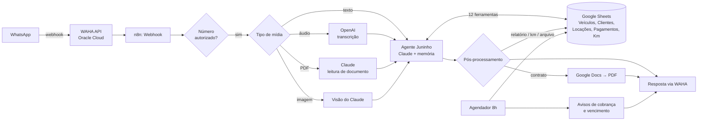

# Juninho: assistente de WhatsApp com IA para uma locadora de veículos

O Juninho é um agente de IA que roda no WhatsApp e cuida da parte administrativa de uma locadora de veículos familiar. O dono conversa com ele em linguagem natural, por texto, áudio, foto ou PDF, e o agente consulta e atualiza a base de dados, gera contratos, registra pagamentos e manda avisos de cobrança sozinho todas as manhãs.

Eu construí o Juninho para o meu pai, que administra a locadora e não queria ficar preso a planilhas e papelada. Ele está **ativo e funciona todos os dias**: atende a locadora pelo WhatsApp e envia os avisos automáticos todas as manhãs.

> Feito com **n8n**, **Claude (Anthropic)**, **OpenAI** (transcrição de áudio), **WAHA (API de WhatsApp) na Oracle Cloud** e **Google Sheets / Drive / Docs**.

---

## O problema

Na locadora, tudo era controlado à mão: quais carros estão alugados, quem pagou o aluguel da semana, quando cada contrato vence, a quilometragem de cada veículo e quando trocar o óleo. Esquecer uma cobrança ou um vencimento custa dinheiro, e montar contrato no Word levava tempo.

## A solução

Um assistente que mora no canal que o dono já usa o dia inteiro: o WhatsApp. Exemplos reais de uso:

| O dono manda... | O Juninho faz... |
|---|---|
| "Quais carros estão disponíveis?" | Consulta a planilha e responde em uma linha por carro |
| Foto da CNH do cliente | Lê os dados do documento, mostra e pede confirmação antes de cadastrar |
| Áudio: "aluga o Mobi pro João a partir de hoje, 450 por semana" | Transcreve, pergunta só o que falta e registra a locação |
| Print do comprovante de Pix | Registra o pagamento vinculado à locação certa |
| "Gera o contrato da locação do João" | Preenche um modelo no Google Docs e devolve o **PDF no WhatsApp** |
| Foto do painel do carro | Lê o odômetro, confirma e grava a quilometragem |
| "Relatório do mês" | Mostra entradas e pendências do mês |
| Contrato antigo em PDF ou Word | Importa os dados e arquiva o documento no Drive |

E, sem ninguém pedir, **todo dia às 8h** ele envia:
- cobrança do aluguel semanal no dia de vencimento de cada cliente;
- aviso de contrato que vence em 3 dias e de contrato que vence hoje;
- alerta de troca de óleo e de limite mensal de km estourado.

## Arquitetura



O workflow tem **75 nós** organizados em três fluxos:

1. **Conversa:** recebe a mensagem, trata a mídia (áudio, imagem, PDF, Word), passa para o agente e devolve a resposta.
2. **Ações estruturadas:** o agente sinaliza na resposta o que deve acontecer (por exemplo, `[[KM:ABC1D23|45230]]`), e o n8n executa a ação de forma determinística: gerar contrato, montar relatório, gravar km, arquivar documento.
3. **Rotina diária:** um agendador lê locações e veículos, calcula quem deve ser cobrado ou avisado e envia as mensagens.

## Decisões de projeto

- **Agente para conversar, código para calcular.** O LLM entende o pedido e conversa. Contas de dinheiro, datas de vencimento, limite de km e montagem do contrato ficam em nós de código JavaScript, para o resultado ser sempre o mesmo. O agente só emite marcadores, como `[[KM:...]]`, e o workflow executa.
- **Confirmação antes de gravar.** Todo cadastro ou alteração passa por um resumo de uma linha e um "Confirma?". Dado ilegível em foto nunca é gravado.
- **Respostas curtas de propósito.** O prompt obriga respostas telegráficas: menos tokens, menos custo e uma leitura mais fácil no celular.
- **Segurança por lista de números.** Só números autorizados (os sócios) conseguem falar com o bot.
- **Ferramentas pequenas e específicas.** Em vez de uma ferramenta genérica de "acessar planilha", o agente tem 12 ferramentas com nome claro (`consultar_veiculos`, `registrar_locacao`, `criar_pagamento`...), o que reduz erros de escolha da ferramenta.
- **Google Sheets como banco de dados.** É barato e o meu pai consegue abrir e conferir tudo sozinho, sem depender de mim.

## Tecnologias

| Camada | Ferramenta |
|---|---|
| Orquestração | n8n (cloud) |
| Agente / LLM | Claude Haiku (Anthropic) via nó AI Agent do n8n, com memória de conversa |
| Áudio | OpenAI (transcrição de áudio em português) |
| Leitura de PDF e imagem | Claude (multimodal) |
| WhatsApp | WAHA (WhatsApp HTTP API), hospedado por mim em uma VM na Oracle Cloud |
| Dados | Google Sheets |
| Contratos e arquivos | Google Docs e Google Drive |
| Lógica de negócio | JavaScript nos nós Code do n8n |

## Estrutura do repositório

```
.
├── README.md
├── workflow/
│   └── juninho.json        # workflow completo do n8n, pronto para importar
└── docs/
    ├── planilha.md         # estrutura das abas da planilha
    └── como-rodar.md       # passo a passo para rodar a sua cópia
```

## Como rodar

Veja [docs/como-rodar.md](docs/como-rodar.md). Em resumo: importe `workflow/juninho.json` no n8n, conecte suas credenciais (Google, Anthropic, OpenAI, WAHA), crie a planilha seguindo [docs/planilha.md](docs/planilha.md) e troque os marcadores `SEU_...` pelos seus valores.

> **Privacidade:** esta é uma cópia pública do workflow. Números de telefone, endereço do servidor, IDs de planilhas e documentos e credenciais foram removidos ou trocados por marcadores. Nenhum dado de cliente está neste repositório.

## Próximos passos

- Testes automatizados para os nós de código (cálculo de cobrança e de limite de km)
- Painel web simples com faturamento e ocupação da frota
- Trocar o Google Sheets por um banco de dados quando a frota crescer

---

Feito por **Maria Fernanda Marques Caputo** · [LinkedIn](https://www.linkedin.com/in/maria-fernanda-caputo-6707762b1/)
